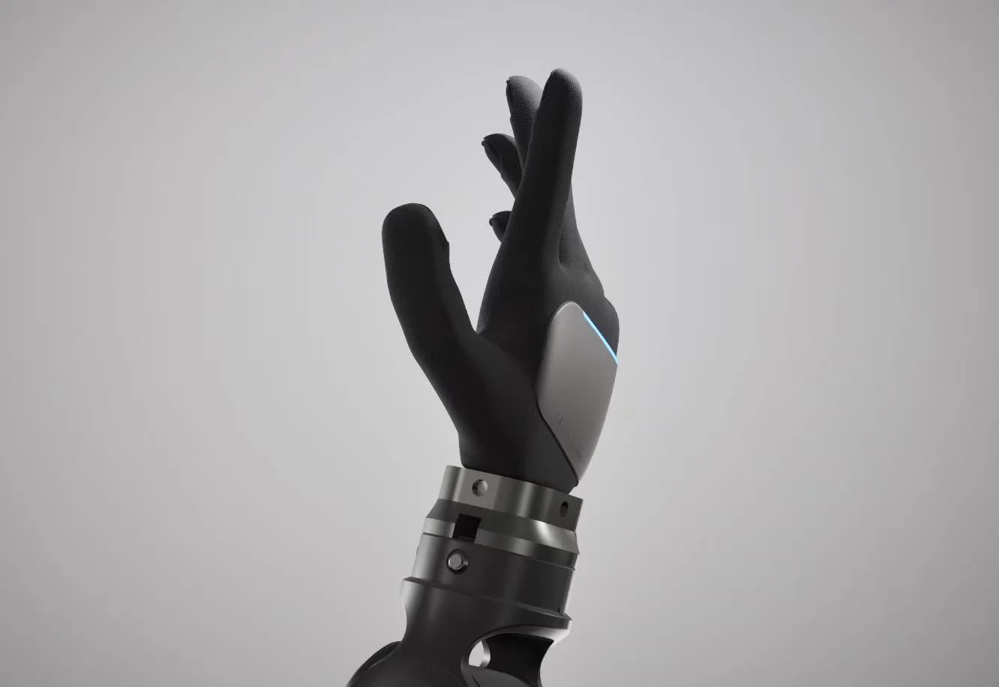

# Aero Hand

An 18-DoF dexterous robot hand, built to learn and deploy on the same hardware.

{ width="420" }

- **18 DoF**, 15 active and 3 coupled
- **10 N** fingertip pinch, **45 N** power grasp
- **≤ 0.5 s** full open to full close
- **≤ 800 g**, IP54

## In this section

- [Specifications](specifications.md)
- [Mechanical integration](mechanical.md)
- [Electrical and communication](electrical.md)
- [Control modes](control.md)
- [Calibration](calibration.md)
- [Maintenance](maintenance.md)
