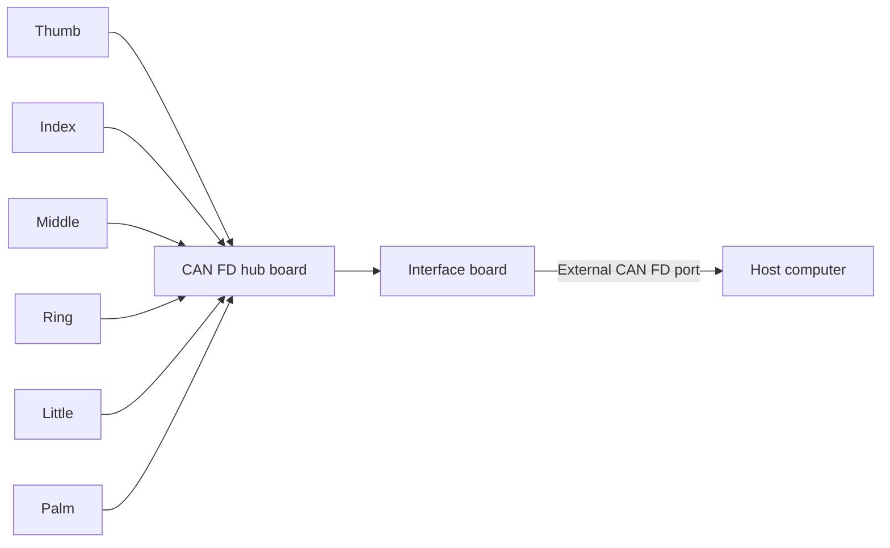

# Tactile interface

How the six tactile modules on Aero Hand connect, mount and report data.

## Architecture

Aero Hand has six tactile modules: one on each fingertip and one on the palm. Each module connects to a CAN FD hub board, which bridges to the Aero Hand interface board. The interface board outputs full-hand tactile data on an external CAN FD port.

The same interface supplies 3.3 V DC to the modules and carries CAN FD communication. The hand's motor control MCU does not process tactile data, so tactile and motor traffic are independent.

## Electrical interface

Each module uses a 4-pin, 0.8 mm pitch connector (HC-0.8-4PLT).

| Pin | Signal | Notes |
|---|---|---|
| 1 | +3V3 | Module power, 3.3 V DC |
| 2 | GND | Ground |
| 3 | CANH | CAN FD high |
| 4 | CANL | CAN FD low |
| 5, 6 | – | Mounting pads, not connected |

!!! tip "Termination"
    The 120 Ω CAN termination resistor is on the hub board. Do not add one on the module side.

## Mechanical interface

- **Fingertips:** each module is fastened to its mounting base with screws, so it can be replaced.
- **Palm:** the module is bonded into the palm pocket with adhesive.

CAD for the tactile modules is listed in [Downloads](../downloads.md#models-and-cad).

## Sensor performance

| Specification | Value |
|---|---|
| Modules | Six: five fingertips and the palm |
| Sensor type | High-resolution multi-dimensional flexible arrays |
| Force resolution | 0.1 N |

## Reading tactile data

*To be written:* CAN FD message IDs, frame layout, and SDK and ROS 2 examples.
