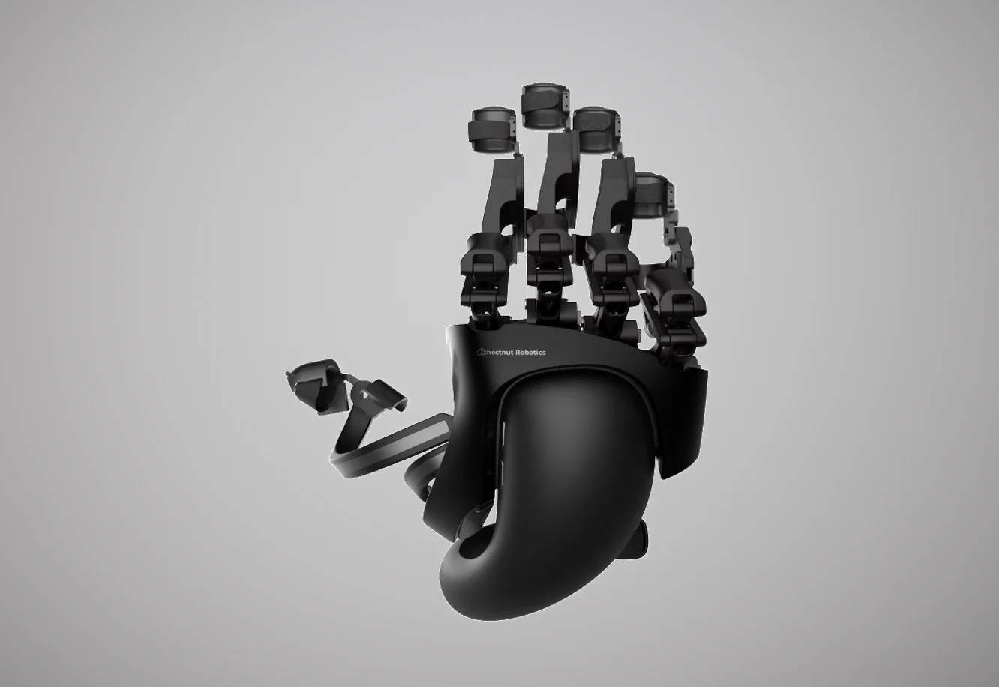

# Aero UMI

A wearable capture device, co-designed with Aero Hand joint for joint.

{ width="420" }

- **18 DoF**, 15 measured and 3 coupled, matching Aero Hand
- **≤ 2 mm** calibrated tracking accuracy
- **~500** tactile channels at **0.1 N** resolution
- **< 1 ms** cross-stream alignment on one clock
- **320 g**, **8 h** continuous capture

## In this section

- [Specifications](specifications.md)
- Wearing and calibration *(coming soon)*
- [Tactile sensing](tactile.md)
- [Head module](head-module.md)
