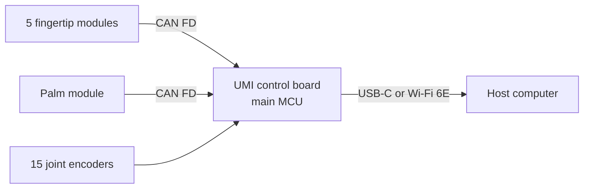

# Tactile interface

How the six tactile modules on Aero UMI connect, mount and report data.

## Architecture

Aero UMI has six tactile modules: one on each fingertip and one on the palm. Each module connects to a CAN FD bus on the UMI control board. The control board's main MCU packages tactile and joint encoder data together and sends it to the host computer over USB.

The same interface supplies 3.3 V DC to the modules and carries CAN FD communication.

## Sensor layout

| Module | Channels |
|---|---|
| Each fingertip (×5) | 54–57 |
| Palm | 213 |
| **Total** | **About 500** |

Each module is a conformal flexible piezoresistive array.

## Sensor performance

| Specification | Value |
|---|---|
| Force resolution | 0.1 N |
| Force axes | Normal (Fn) and 2D shear (Ft) |
| Output | Per-point 3D force vectors and a resultant 3D force vector per module |
| Sensing range | 0.1–20 N |
| Refresh rate | 70–100 Hz |

## Electrical interface

Same connector and pinout as [Aero Hand](../aero-hand/tactile.md#electrical-interface): 4-pin, 0.8 mm pitch (HC-0.8-4PLT).

| Pin | Signal |
|---|---|
| 1 | +3V3 |
| 2 | GND |
| 3 | CANH |
| 4 | CANL |

!!! tip "Termination"
    The 120 Ω CAN termination resistor is on the UMI control board. Do not add one on the module side.

## Mechanical interface

- **Fingertips:** self-contained modules mounted onto the UMI fingertips.
- **Palm:** bonded into the palm pocket with adhesive, as on Aero Hand.

## Reading tactile data

*To be written:* topic names, message schema and a Python example.
