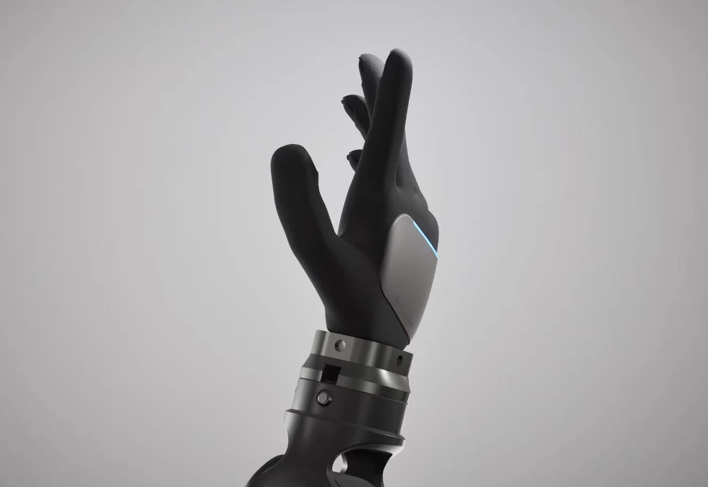
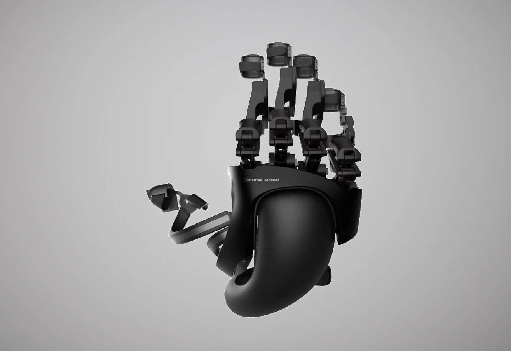
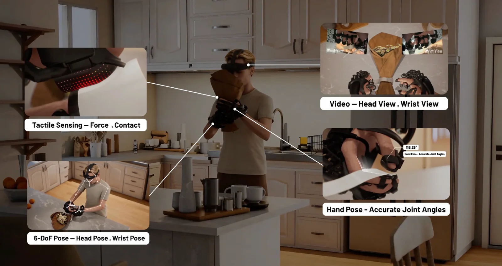

---
hide:
  - navigation
  - toc
---

# Chestnut Developer Docs

Set up, integrate and build with Aero Hand, Aero UMI and Chestnut data.

<a class="card" href="aero-hand/">
<strong>Aero Hand</strong>18-DoF dexterous robot hand
</a>
<a class="card" href="aero-umi/">
<strong>Aero UMI</strong>Wearable capture, matched joint for joint
</a>
<a class="card" href="data/">
<strong>Contact-Rich Data</strong>Sample data, format and viewer
</a>

## Start here

<strong>Quick Start, Aero Hand <em class="soon-tag">Coming soon</em></strong>Power on, connect and run your first motion

<strong>Quick Start, Aero UMI <em class="soon-tag">Coming soon</em></strong>Put it on, calibrate and record an episode

<strong>Software <em class="soon-tag">Coming soon</em></strong>SDK, ROS 2, URDF and teleoperation

<a class="card" href="downloads/">
<strong>Downloads</strong>SDKs, firmware, models and CAD
</a>

## Research

<a class="card" href="https://chestnut-robotics.github.io/aero-system/">
<strong>Aero: Capturing Motion and Touch for Dexterous Robot Learning</strong>The project page: why Aero UMI and Aero Hand are co-designed, with demonstration videos
</a>
<a class="card" href="research/">
<strong>All research</strong>Projects, publications and citations
</a>

## Need help?

[Contact us](https://chestnut.bot/contact.html) and we will help you get set up.
