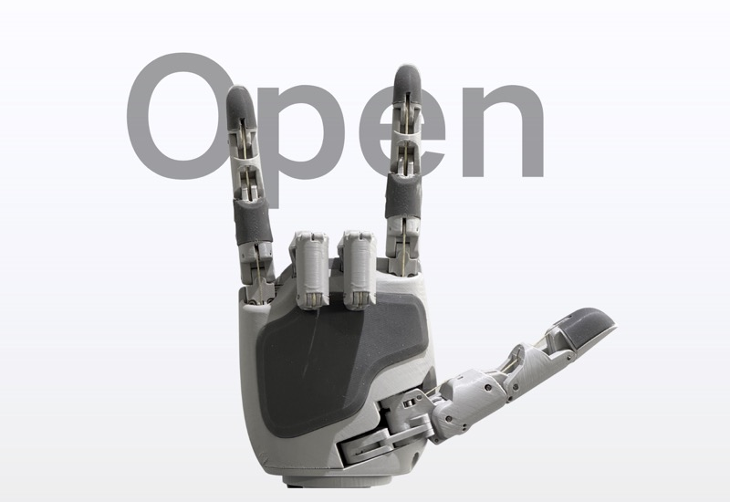

# Research

The research behind our hardware.

## Publications

<div class="cards cards--single">
<a class="card" href="https://arxiv.org/abs/2608.28578"><div class="card-body"><strong>Aero Hand Open: A Simulation-Ready Tendon-Driven Hand for Dexterous Manipulation Learning</strong><span>arXiv 2026. A tendon-driven hand released with its simulation model, actuation map and RL package, so policies trained in simulation run on the real hand.</span></div></a>
</div>

[Paper](https://arxiv.org/abs/2608.28578){ .md-button .md-button--primary }
[Project page](https://chestnut-robotics.github.io/aero-hand-open/){ .md-button }
[Code and CAD](https://github.com/Chestnut-Robotics/aero-hand-open){ .md-button }

Nan Wang, Mohit Yadav, Jonathan Wulff, Aidan Rosenbaum, Kezhou Chen, Yuvan Sharma, Xu Dong, Yiwei Tao

## Cite

```bibtex
@misc{wang2026aerohandopen,
  title         = {Aero Hand Open: A Simulation-Ready Tendon-Driven Hand for Dexterous Manipulation Learning},
  author        = {Nan Wang and Mohit Yadav and Jonathan Wulff and Aidan Rosenbaum and Kezhou Chen and Yuvan Sharma and Xu Dong and Yiwei Tao},
  year          = {2026},
  eprint        = {2608.28578},
  archivePrefix = {arXiv},
  primaryClass  = {cs.RO},
  url           = {https://arxiv.org/abs/2608.28578}
}
```
