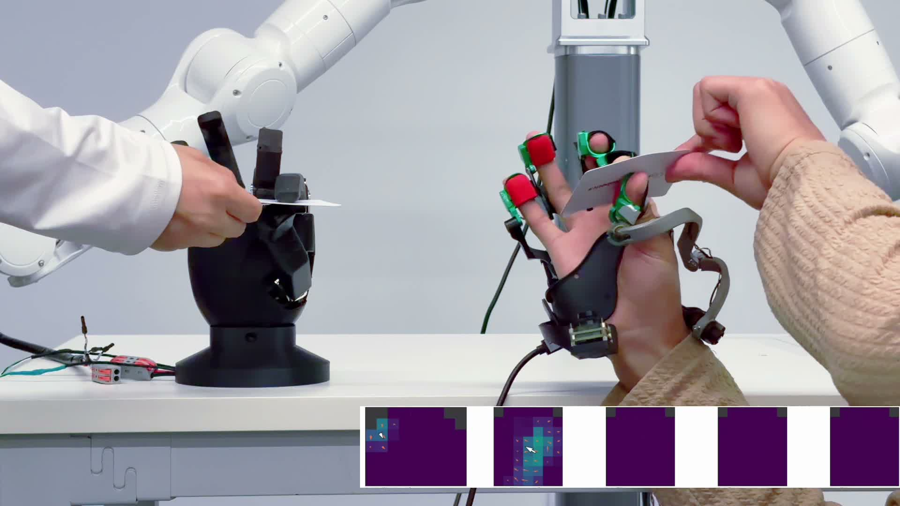

# Research

The research behind our hardware, with project pages for each publication.

## Projects

<a class="card" href="https://chestnut-robotics.github.io/aero-system/">
<strong>Aero: Capturing Motion and Touch for Dexterous Robot Learning</strong>Co-designing a wearable demonstration interface and a five-finger robot hand. Abstract, system design and demonstration videos.
</a>

## Publications

*To be written:* papers, preprints and talks.

## Cite

*To be written:* BibTeX entries.
